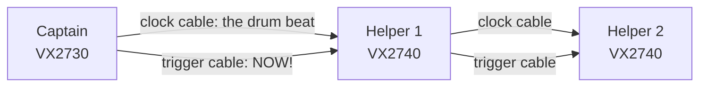
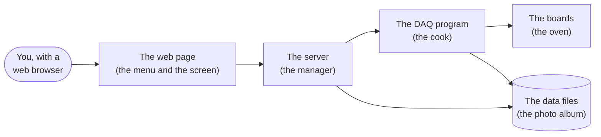

# How Vx27webDAQ works — explained for kids

Hi! This page explains what this program does, how its parts work together, and how people use it. You do not
need to know any programming. If a word is new, look in [Words to know](#words-to-know) at the end.

## What is it for?

Scientists build **detectors**: machines that notice tiny particles flying through them. When a particle hits a
detector, the detector makes a very short electric **blip** — much shorter than a blink. It lasts a few billionths
of a second.

To see the blip, scientists use special electronic boards called **digitizers**. A digitizer is like a camera for
electricity: it measures the voltage (how strong the electricity is) again and again, super fast, and writes down
every number. Our fastest board takes **500 million measurements every second**. Each measurement is called a
**sample**, and a row of samples drawn as a line is a **waveform** — the picture of the blip.

**Vx27webDAQ** is the program that tells the boards what to do, collects all those numbers, saves them, and shows
them on a web page, so the whole lab can watch at the same time. ("DAQ" means **D**ata **AQ**uisition: collecting
data.)

## Meet the team: the boards

Our lab has one **captain** and some **helpers**:

| Board | Job | Inputs | Measurements per second |
|---|---|---|---|
| **VX2730** | the captain (the "master") | 16 | 500 million |
| **VX2740** | the helpers | 64 each | 125 million |

Each input is called a **channel**. One detector cable goes into one channel.

The boards are connected one after the other with two kinds of cables, like children passing a message along a
line:

- The **clock cable** is like a drum beat that everybody marches to. Because all boards hear the same beat, their
  clocks agree, and later we can tell exactly which blips happened at the same moment.
- The **trigger cable** is like the captain shouting "**NOW!**". The captain watches its own channels. When a blip is
  big enough, it shouts, and every helper takes a picture at that very moment. One picture of all channels is
  called an **event**.

How big must a blip be? That is the **threshold** — like a rule "only shout when the wave is taller than this line".

## Meet the programs

Vx27webDAQ is not one program but a small team of programs. Think of a restaurant:

| Part | In the restaurant | What it really does |
|---|---|---|
| **The web page** | the menu and the screen in the dining room | what you see in your browser: buttons, settings, the waveforms |
| **The server** | the manager | knows who is allowed to do what, keeps notes, starts the cook, tells everybody what is happening |
| **The DAQ program** | the cook | the only one who talks to the boards: it sets them up, starts them, reads their numbers and writes them into files |
| **The simulator** | a pretend kitchen for practice | fake boards inside the computer, so we can test everything without the real ones |
| **The data files** | the photo album | every number the boards sent, kept exactly as they sent it (`.raw` files), and a copy in the format scientists like (`.root` files) |

Why is the cook a separate program from the manager? So that if the manager has to restart (for example after an
update), the cook keeps cooking — the measurement goes on.

## A map of the folders

When you open the project on GitHub, you see folders. Here is what lives in each one:

| Folder or file | What lives there |
|---|---|
| `src/vx27webdaq/core/` | the **rule book**: what a correct setup looks like, the exact instructions each board gets, and how the photo album (the data files) is organized |
| `src/vx27webdaq/daq/` | the **cook** (the DAQ program), the board helper that talks to the real boards, and the **simulator** (the pretend boards) |
| `src/vx27webdaq/web/` | the **manager** (the server): accounts, runs, files, the board check |
| `src/vx27webdaq/web/static/` | the **web page** itself: pictures, colors, buttons, and the words in English, Chinese and Japanese |
| `tests/` | the **robot checker**: little programs that try every part and shout if something is wrong |
| `setup.sh`, `build.sh`, `caen_libs.sh` | the **toolbox**: get the parts, put the program on the lab computer, get the boards' own software |
| `run_tests.sh` | starts the robot checker |
| `version.sh`, `CHANGELOG.md` | the **numbering**: every change gets a new version number (like v0.1.29) and a sentence about what changed |
| `README.md`, `INSTALL.md` | the instruction leaflets for grown-ups |
| `docs/` | this page |

## A run, step by step

Collecting data for a while is called a **run**. It is a bit like taking class photos:

1. **Plan the photo** (Configuration page): which boards, which channels, how tall the threshold line is, how
   long to measure, where to save the files.
2. **Check that everybody is there** (Check boards): the program says "hello" to every board and asks "who are
   you?". Each board answers with its name and serial number. Green means OK.
3. **Tell everybody the plan** (Send to boards, optional): each board gets all its settings, to see that it
   understands them.
4. **Start!** (Start run): the cook sets up every board again, arms them (gets them ready), and tells the captain
   to start. The drum beat (clock cable) starts the helpers at exactly the same moment.
5. **Watch** (the Run page): waveforms appear live, and numbers show how many events each board has recorded.
6. **Stop** (Stop, or when the time is up): the captain stops, every board sends its last pictures and a
   "goodbye" message called the **stop record**.
7. **The album**: every board's numbers are saved in a `.raw` file; then each one is copied into a `.root`
   file, and one extra file puts all boards' pictures of the same moment side by side (`RUN_built.root`).

## How to use it (with a grown-up from the lab)

1. The program runs on the lab's computer. You reach it through a **secret tunnel** made with a command called
   `ssh`: `ssh -L 8770:localhost:8770 DAQ-COMPUTER`. Keep that window open.
2. Open the address **http://localhost:8770** in your browser.
3. Without signing in you can **watch** (you are a "viewer"). To press the buttons that change things, a grown-up
   signs in as an **operator**. The **admin** manages who may sign in.
4. Want to practice without the real boards? In **Settings** switch on the **simulator**. Then everything works with
   pretend boards, and the page reminds you that the data are pretend.

## Words to know

| Word | Meaning |
|---|---|
| **sample** | one measurement of the voltage: one number |
| **waveform** | many samples in a row, drawn as a line: the picture of a blip |
| **channel** | one input of a board, for one detector cable |
| **trigger** | the signal that says "take a picture NOW" |
| **threshold** | how big a blip must be to start a trigger |
| **baseline** | the voltage when nothing happens: the flat part of the line |
| **event** | one picture of all channels at one moment |
| **timestamp** | the time of an event, counted in steps of 8 billionths of a second since the run started |
| **run** | collecting data for a while, from Start to Stop |
| **simulator** | pretend boards inside the computer, for practice and tests |
| **bug** | a mistake in a program |
| **test** | a little program that checks that another program does the right thing |

## How we hunt for bugs

Programs are written by people (and helpers like an AI assistant), and people make mistakes. So we check a lot:

- **The robot checker** (`./run_tests.sh`) runs 161 little tests every time something changes: it makes
  pretend runs with the simulator and checks every number in the files.
- **System tests** try the whole thing the way the lab uses it: every way of triggering, every number of boards,
  thousands of strange requests to the server, and a robot that clicks every button on every page.
- **Fresh eyes**: other reviewers read the code without having written it, because the writer of a mistake often
  does not see it.

In November 2026 one big bug hunt like this found 126 bugs, from tiny ones to serious ones, and every one was
fixed. Here are four of them, explained with everyday pictures:

- **Two kids, one notebook.** Two parts of the simulator wrote in the same notebook at the same time. One wrote
  "the run stopped at 10 o'clock", but the other had already written a picture from a moment later. So one board
  had one picture more than the others. The fix: only one may hold the notebook at a time while writing the time.
- **The recipe with a backup.** A step of a recipe says: "fat: butter, or margarine if there is no butter". There
  was no butter, so the cook crossed out the whole *fat* step before trying the margarine, and then skipped every
  crossed-out step. So the cake got no fat at all! Some boards got no trigger setting this way. The fix: try the
  margarine first, and cross out a step only when nothing in it works.
- **Matching photos by their number.** Each helper numbers its photos 1, 2, 3, … To put the photos of the same
  moment side by side, we matched photo 5 with photo 5. But when one helper blinked and missed a photo, all its
  later numbers were one too small, and every later pair was wrong! The fix: match the photos by the time on them.
  All the boards march to the same drum beat, so their times agree.
- **Two people, one plan.** Two grown-ups can change the run plan from two computers at once. The second one to
  type wiped out the first one's change, and nobody noticed. Now every change says which version of the plan it
  started from. If the plan changed in between, the page puts your change on top of the new plan instead.

Every bug we fix gets its own little test, so the robot checker would notice if the same mistake ever came back.
